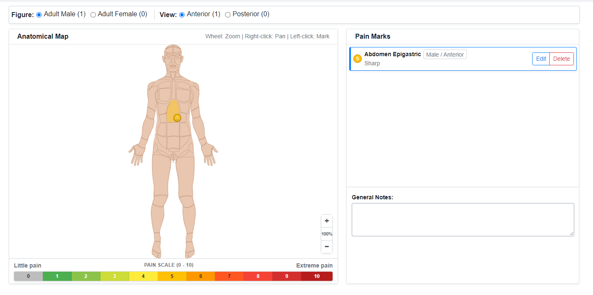
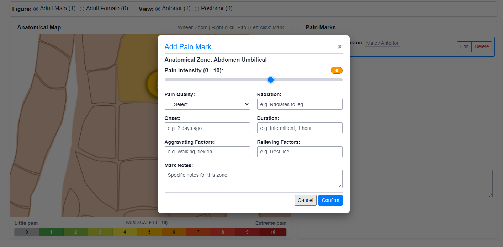
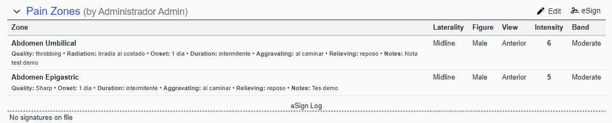

# 🩺 Pain Zones Encounter Form for OpenEMR (`pain_zones`)

[-blue.svg?logo=circle&logoColor=white)](https://www.open-emr.org)
[](https://www.php.net)
[](#-database-schema)
[](#-verified-compatibility)
[](#-key-features)
[](LICENSE)

Interactive clinical encounter form for anatomical pain mapping in **OpenEMR**. Allows clinicians to record pain points on standardized vector body diagrams (Male / Female, Anterior and Posterior views), calculate exact relative coordinates, assign 0–10 NRS pain intensity, choose qualities from OpenEMR's `list_options`, and output clean tabular summaries into encounter notes.

---

## 📑 Table of Contents

- [✨ Key Features](#-key-features)
- [📸 Screenshots](#-screenshots)
- [🗄️ Database Schema](#-database-schema)
- [📊 Clinical Pain Scale](#-clinical-pain-scale)
- [📁 Directory Structure](#-directory-structure)
- [🚀 Installation & Setup](#-installation--setup)
- [🩺 Clinical Workflow](#-clinical-workflow)
- [🔎 Visit Comparison & Heat Map](#-visit-comparison--heat-map)
- [🖨️ Encounter Reports](#-encounter-reports)
- [🛡️ Access Control (ACL)](#-access-control-acl)
- [💻 Verified Compatibility](#-verified-compatibility)
- [📜 License](#-license)

---

## ✨ Key Features

- 📍 **Vector Anatomical Mapping (SVG):**
  - **Body Diagrams:** High-resolution SVG diagrams for Adult Male and Adult Female across Anterior and Posterior views.
  - **Exact Coordinates:** Mathematical projection via screen CTM inversion (`getScreenCTM().inverse()`), recording sub-metric relative percentages (`x_pct`, `y_pct` from `0.000%` to `100.000%`) invariant to monitor DPI or browser zoom.
  - **Anatomical Whitelist:** Strict server-side verification of recognized region identifiers (`head`, `neck`, `chest`, `abdomen`, `pelvis`, `spine`, limbs, `genitals`, `perineum`).

- 🔍 **Interactive Zoom & Pan:**
  - **Mouse Wheel:** Smooth zoom centered on the cursor from 1x up to 5x.
  - **Right-Click Drag:** Free panning across the enlarged figure with native context menu suppression.
  - **Left-Click:** Dedicated to placing or inspecting pain marks (with 6px movement tolerance to prevent accidental marks during pan).
  - **On-Screen Controls:** Floating zoom buttons (+, 100%, −) convenient for laptops with touchpads.
  - **Touch Gestures:** Pinch-to-zoom and single-finger drag on mobile devices and clinical tablets.

- 🎨 **Dynamic Highlighting & Tinting:**
  - **Unmarked Zone Hover:** Moving the cursor over asymptomatic body regions lights up the area in soft light gray (`#d5dbdb`, 55% opacity) to clearly show exact zone boundaries before clicking.
  - **Severity Color Tints:** Marked body regions are automatically tinted with the color corresponding to the highest pain intensity recorded in that zone (`fill-opacity: 0.45`).
  - **High-Contrast Numbered Pins:** Circular pins displaying the intensity level (0–10) with elevation shadows and brightness on hover.
  - **Rich Multi-Line Tooltips:** Hovering over a marked zone displays a popover with the zone name and details for all pains registered there.

- 📊 **Horizontal Pain Scale Bar:**
  - A color-coded reference bar (levels 0 to 10) positioned directly beneath the anatomical map.
  - Displays the clinical progression from *Little pain* to *Extreme pain*.
  - Interactive: clicking any colored level in the bar sets the intensity slider when the mark dialog is open.

- 📋 **Structured Semiological Evaluation:**
  - **Intensity:** Numeric Rating Scale (NRS) 0 to 10.
  - **Pain Quality:** Dropdown populated from OpenEMR's `list_options` (`pain_zones_quality`), with a custom text field if "Other" is selected.
  - **Clinical Fields:** Radiation path, onset/chronology, duration, aggravating factors, relieving factors, and mark-specific notes.
  - **General Notes:** Encounter-level observations textarea.

- 📑 **Global Sidebar List:**
  - Centralized list displaying all marks recorded across all 4 body panels.
  - Instant navigation: clicking any card in the list automatically switches the panel to that figure and view.

- 🧾 **Editable Clinical Summary (`summary_text`):**
  - A **Summary Text** box sits below General Notes in the form. Confirming or deleting a mark auto-fills it from the current marks and general notes using a fixed, deterministic template (no AI, no free-form generation).
  - One line per mark ordered by intensity descending: translated anatomical zone plus laterality, severity band and `N/10`, then only the semiology fields that hold a value (quality, radiation, onset, duration, aggravating, relieving, notes). General notes are appended as a final line; with no marks a fixed translatable phrase is shown.
  - The clinician can correct the text before saving and the reviewed text is persisted with the form. A **Regenerate** link rebuilds it from the current marks. If the field is missing (legacy client), the server regenerates it inside the save transaction.
  - Stored as plain text (never HTML) and intended as context for the SOAP note.

- 🔎 **Read-Only Visit Comparison (`compare.php`):**
  - Patient-scoped, read-only view that correlates the **confirmed** marks of previous visits over a selectable date range (last 30 days, 3/6/12 months, all time, or a custom window).
  - **Overlay mode:** renders the pins of up to five visits on the same figure, one distinct color per visit, with an auto-selected "last 3 visits" default.
  - **Heatmap mode:** tints each anatomical zone by a chosen metric (**Maximum** by default, **Average** or **Count** of visits), computed from the highest intensity recorded per zone and visit.
  - Includes a per-visit totals table and a zone heat table, a color legend, printable layout, and entry points from the form and the encounter report.

---

## 📸 Screenshots

| Anatomical Map & Zoom Controls | Mark Assessment Dialog |
|:---:|:---:|
|  |  |
| *Anatomical map with tinted zones, zoom controls, and bottom scale bar.* | *NRS intensity slider, pain quality dropdown, and semiology fields.* |

| Encounter Report |
|:---:|
|  |
| *Structured tabular summary integrated into the patient's encounter history.* |

---

## 🗄️ Database Schema

The module provisions three relational tables and populates two lists in `list_options` (`table.sql`):

1. **`form_pain_zones` (Form Header):**
   - Binds the clinical encounter (`id`, `date`, `pid`, `user`, `groupname`, `authorized`, `activity`).
   - Stores `general_notes` (up to 5,000 characters) and the editable plain-text `summary_text` (auto-filled from the marks and reviewable before saving, with server-side regeneration as fallback; see `pz_buildSummary()` in `pain_zones.inc.php`).

2. **`form_pain_zones_marks` (Pain Marks):**
   - Records each pain point: `figure`, `body_view`, `zone_id`, `laterality`, `x_pct`, `y_pct`, `intensity` (0–10), `pain_quality`, `radiation`, `onset`, `duration`, `aggravating`, `relieving`, `notes`, and active flag (`activity = 1`, soft-deleted if `0`).

3. **`form_pain_zones_history` (Audit Log):**
   - Records an entry on insert, update, or soft-delete with timestamp, user ID, and a JSON `snapshot` of the mark's full state.

4. **`list_options` (`pain_zones_level`):**
   - Preconfigured NRS levels (`level_0` to `level_10`) with hex color definitions (`stroke` and `fill`) and severity bands (`none`, `mild`, `moderate`, `severe`).

5. **`list_options` (`pain_zones_quality`):**
   - Clinical pain qualities (*sharp*, *dull*, *burning*, *throbbing*, *stabbing*, *cramping*, *pressing*, *shooting*, *aching*, *electric*, *tingling*, *heavy*, *other*).
   - Fully customizable and translatable in OpenEMR under **Administration > Lists**.

---

## 📊 Clinical Pain Scale

| NRS Level | Severity Band | Color | Hex (Stroke / Fill) | Clinical Significance |
|:---:|:---:|:---:|:---:|:---|
| **0** | **None** | ⚪ Grey | `#848484` / `#BDBDBD` | No pain / baseline resolved state |
| **1** | **Mild** | 🔵 Blue | `#1565C0` / `#42A5F5` | Very mild, barely noticeable |
| **2** | **Mild** | 🔵 Sky Blue | `#0277BD` / `#29B6F6` | Minor pain, does not interfere with daily life |
| **3** | **Mild** | 🟢 Teal | `#00695C` / `#26A69A` | Tolerable, manageable |
| **4** | **Moderate** | 🟢 Green | `#2E7D32` / `#66BB6A` | Begins to interfere with concentration |
| **5** | **Moderate** | 🟡 Lime | `#558B2F` / `#D4E157` | Distracting, limits routine activities |
| **6** | **Moderate** | 🟡 Amber | `#F9A825` / `#FFEE58` | Substantial impact on daily activities |
| **7** | **Severe** | 🟠 Orange | `#E65100` / `#FFA726` | Dominates senses, impedes movement |
| **8** | **Severe** | 🔴 Deep Orange | `#BF360C` / `#FF7043` | Severe functional limitation |
| **9** | **Severe** | 🔴 Crimson | `#B71C1C` / `#EF5350` | Intense pain, conversation impaired |
| **10** | **Severe** | 🟣 Purple | `#4A148C` / `#AB47BC` | Worst imaginable pain, immediate care required |

> [!TIP]
> Palette colors and level labels can be adjusted in OpenEMR under **Administration > Lists > Pain Zones Level**.

---

## 📁 Directory Structure

```text
interface/forms/pain_zones/
├── 📂 assets/
│   ├── female_anterior.svg     # Adult female anterior diagram
│   ├── female_posterior.svg    # Adult female posterior diagram
│   ├── male_anterior.svg       # Adult male anterior diagram
│   └── male_posterior.svg      # Adult male posterior diagram
├── info.txt                    # OpenEMR form display name
├── lang_custom.sql             # Latin American Spanish translations
├── LICENSE                     # GNU General Public License v3.0 text
├── compare.php                 # Read-only visit comparison and zone heat map
├── new.php                     # Interactive map, editing, and view interface
├── pain_zones.inc.php          # Backend helpers, ACL checks, and palette queries
├── README.md                   # English technical documentation
├── README_es.md                # Spanish technical documentation
├── report.php                  # Tabular encounter report generator
├── save.php                    # Transactional database persistence endpoint
├── table.sql                   # Database table definitions and list_options seed
└── view.php                    # Redirect handler to new.php in view mode
```

---

## 🚀 Installation & Setup

### 1. File Placement
Copy or clone the `pain_zones` directory into your OpenEMR forms folder:
```bash
cp -r pain_zones /var/www/html/openemr/interface/forms/
chown -R www-data:www-data /var/www/html/openemr/interface/forms/pain_zones
```

### 2. Database Initialization
Run the SQL schema file to create tables and seed lists:
```bash
mysql -u openemr -p openemr < /var/www/html/openemr/interface/forms/pain_zones/table.sql
```

*(Optional)* If you want full Latin American Spanish translations:
```bash
mysql -u openemr -p openemr < /var/www/html/openemr/interface/forms/pain_zones/lang_custom.sql
```

### 3. OpenEMR Registration
1. Log in to OpenEMR with an administrator account.
2. Navigate to **Administration > Forms**.
3. In the unregistered forms tab, locate **Pain Zones** (`pain_zones`).
4. Click **Register** and then **Install DB** if prompted.

---

## 🩺 Clinical Workflow

1. **Open Form:** During an active encounter, select **Clinical Forms > Pain Zones**.
2. **Figure:** the body diagram is **fixed to the patient's recorded sex at birth** (`patient_data.sex`, the *Sex at birth* field): a **Female** patient gets the female diagram, **Male** the male one, and anything else (empty or `UNK`) falls back to the male diagram **with a visible warning** asking to complete the sex in the patient record. The figure is **not user-selectable**. If a saved form still holds marks drawn on the opposite figure (legacy data), a figure selector appears offering both panels so those marks remain reachable — never hidden.
3. **Zoom & Position:** Use the mouse wheel or floating buttons to zoom in. Drag with the right mouse button to pan across the figure.
4. **Place Mark:** Left-click on any body zone. Enter the intensity (0–10), quality, radiation, and notes in the dialog.
5. **Edit or Remove:** Click any pin on the map or select an entry in the sidebar list to modify or delete a mark.
6. **Review & Save:** Confirming each mark fills the editable **Summary Text** box; correct it if needed (or click **Regenerate**). Clicking **Save Form** persists the marks and the reviewed summary in a single transaction, then the tab closes, refreshing the encounter view.

---

## 🔎 Visit Comparison & Heat Map

`compare.php` is a **read-only**, patient-scoped page that puts the current pain picture next to previous ones. It never writes to the database and requires the same `patients/med` read permission as the form. It reads only **confirmed** (`review_status = 'confirmed'`) and active (`activity = 1`) forms of the patient in the session; drafts and soft-deleted visits are ignored.

**Filters (all validated server-side; unknown values fall back to defaults):**

- **Date Range:** last 30 days, last 3 / 6 / 12 months (default), all time, or a custom `From`–`To` window. Impossible dates fall back to the default 12 months, and a reversed window is swapped automatically.
- **Figure / View:** the figure is **fixed to the patient's recorded sex** (`patient_data.sex`): a female patient sees the female diagram, everyone else the male one. It is not user-selectable, so a stale `?figure=…` link is ignored. Only the **View** (Anterior or Posterior) is chosen; the page opens on the panel that has the most data in the selected range.
- **Mode:** Overlay or Heatmap.
- **Heat Metric:** Maximum (default), Average, or Count.

**Overlay mode** draws the pins of the selected visits on a single figure, one distinct color per visit (Okabe–Ito palette), with a legend that maps each color to its visit date. Up to **5** visits can be overlaid; the page preselects the **3 most recent** and the browser prevents ticking a sixth. A hidden `visits_present` field distinguishes "no visits selected" from "not submitted", so clearing the selection is respected instead of silently re-defaulting.

**Heatmap mode** tints each anatomical zone by the selected metric. Because a zone can be marked several times in one visit, the heat value is always derived from **one value per zone and visit** — the highest intensity recorded for that zone in that visit:

- **Maximum:** the highest per-visit value across the range (0–10 palette, same colors as the form).
- **Average:** the mean of the per-visit values.
- **Count:** the number of distinct visits in which the zone was marked (sequential light-to-dark scale).

Both modes sit next to a **per-visit totals table** (date, marks, maximum, average) and, in heatmap mode, a **zone heat table** sorted by the active metric. Every number is scoped to the selected figure and view panel. Hovering a zone shows a tooltip with its visits, marks, maximum, average, and last visit. The layout prints cleanly via the **Print** button.

**Zoom & pan.** The anatomical map supports the same navigation as the entry form: **mouse-wheel zoom** centred on the cursor (1×–5×), **right-click drag** to pan, floating **+ / 100% / −** buttons, and touch gestures (pinch to zoom, drag to pan when zoomed). The controls are hidden when printing, and any filter change (visit, range, view or mode) reloads the page with the map back at 100%, since the zoom state is intentionally not persisted.

**Printing.** The heat/intensity legend is rendered as an **inline SVG** (`pz_heatLegendSvg()`) instead of a CSS gradient, because browsers drop `background` colours and gradients when printing to PDF — that used to leave the legend as an empty bordered box. SVG fills are content and always print.

Entry points: the **Compare Visits** button in the form's action bar and the **Compare with previous visits** link in the encounter report. Both load the page inside the current encounter tab (the same pattern the AI assistant module uses), so the OpenEMR tab layout is preserved. A **Go Back** button returns to the Pain Zones form the page was opened from — or, when opened from the encounter report, to the encounter form list.

---

## 🖨️ Encounter Reports

The file `report.php` implements `pain_zones_report()`. It generates a clean HTML table detailing all marks, intensities, qualities, and notes, which OpenEMR embeds automatically into the patient's encounter record and printable chart export.

**Body figure.** The on-screen report shows the **marks table only** — no figure is drawn inline. Hovering a row opens a **floating window** next to the cursor with the body figure plus that mark's clinical detail. The figure is the **representative panel** for that form (the figure + view that holds the most marks; ties break toward Adult Male / Anterior), with its anatomical zones tinted by intensity and one pin per mark, reusing the same coloring logic as the comparison heat map. Inside the window the hovered mark's **zone and pin are highlighted** while the rest fade into the background; the clinical lines show zone, laterality, an intensity badge, band, quality, radiation, onset, duration, aggravating/relieving factors, and notes.

- **In the PDF export** the figure is embedded beside the marks table as ``. This is deliberate: mPDF only draws SVG that is referenced as an **image** (``/`<input>`/`<meter>`); an inline `<svg>` element is silently ignored. The SVG is sanitised (`pz_sanitizeSvgForPdf()`) — no metadata, filters, or editor namespaces — so it renders without temporary files.

The PDF/HTML switch is decided by `$GLOBALS['PDF_OUTPUT']`, which OpenEMR's `custom_report.php` sets for printable exports; the encounter summary (`forms.php`) does not set it.

Separately, the editable plain-text clinical summary stored in `summary_text` (auto-filled by the form, with server-side `pz_buildSummary()` as fallback) provides a compact, human-readable digest of the marks for use as context in the SOAP note. It is not the same as the tabular report.

---

## 🛡️ Access Control (ACL)

Access is controlled via OpenEMR's standard `patients/med` section permissions:

- **Write Permission (`write` / `addonly`):** Allows users to add, edit, soft-delete marks, and save changes.
- **Read-Only Permission (`view` / `read`):** Allows users to view the form, zoom, pan, and read mark details in read-only mode with inputs disabled.
- **Unauthorized:** Users without read access to `patients/med` are blocked with an HTTP 403 response via `AccessDeniedHelper`.

---

## 💻 Verified Compatibility

> [!IMPORTANT]
> **Production-Tested Versions:**
> This module has been verified on:
> - **OpenEMR 8.2.0** (PHP 8.2 / 8.3)
> - **OpenEMR 8.4.1** (PHP 8.2 / 8.3)
>
> **Note on earlier versions:** Compatibility with OpenEMR 7.0 or earlier is not guaranteed because the code relies on modern OpenEMR 8.x architecture (`QueryUtils::inTransaction()`, `SessionWrapperFactory`, `PatientSessionUtil`, `EncounterSessionUtil`, PSR-4 namespaces, and `EncounterFormAccess`).

- **Databases:** MySQL 5.7+ / 8.0+ or MariaDB 10.4+.
- **Browsers:** Modern versions of Google Chrome, Mozilla Firefox, Microsoft Edge, and Safari with SVG and ES6 support.

---

## 📜 License

This project is licensed under the **GNU General Public License v3 (GPL-3.0)**. See the [`LICENSE`](LICENSE) file for the full license text. OpenEMR is a registered trademark of the OpenEMR Foundation.
